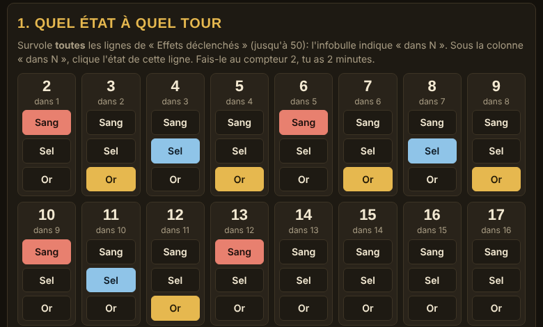
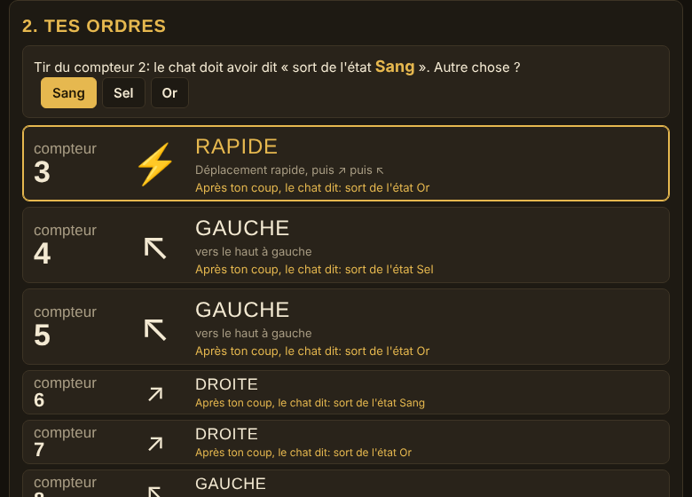

# Âme en peine: plan de route

Outil pour passer le **Labyrinthe des âmes** (quête « Une âme en peine », Dofus Pourpre) contre le **Minogolem séculaire**. Tu lui donnes la liste des états du Minogolem, il te donne les déplacements à jouer, compteur par compteur, en anticipant les murs qui vont apparaître.

Une seule page HTML, sans installation: ouvre `index.html` dans ton navigateur, ou le lien direct ci-dessous.

**Lien direct:** https://hakuuuuuuuuuu.github.io/Dofus-Pourpre-me-en-peine/



## Notice d'utilisation

### Repères

- Le **compteur** est le chiffre à côté de la petite horloge, près du chrono de tour. Tous les ordres sont donnés **par numéro de compteur**.
- Tu pars en bas de la carte, la sortie est tout en haut.
- ↖ gauche, ↗ droite (vers le haut), ↙ et ↘ reculent. PASSE: ne bouge pas. RAPIDE: sort Déplacement rapide.

### Pas à pas

1. **Passe ton premier tour** (compteur 1) sans rien faire.
2. **Au compteur 2**, fais un **clic droit sur le Minogolem séculaire**. Sa fiche s'ouvre: la liste « Effets déclenchés » donne ses états.
3. **Passe la souris sur chaque ligne « État … »**. L'infobulle indique « dans N ». Dans la grille « 1. Quel état à quel tour », clique, sous la colonne « dans N », l'état de cette ligne.
   - L'ordre d'affichage de la liste du jeu n'est **pas** l'ordre de déclenchement. Seul le « dans N » compte.
   - Lis **toutes** les lignes. Remplis les colonnes sans trou: une colonne vide arrête le plan.
   - Tu as environ 2 minutes au compteur 2.
4. **Joue les ordres** de « 2. Tes ordres », en commençant par le cadre doré. Après chaque coup, clique « Joué ✓ ».
5. **Vérifie le chat à chaque tour.** Après ton coup, le Minogolem déclenche un état et le chat dit « sort de l'état X ». X doit être celui annoncé sous l'ordre. Sinon, clique le bon état dans la barre « Tir du compteur… »: le plan est recalculé depuis ta vraie position.
6. **À chaque fois que la liste des états du jeu est rafraîchie, mets les états à jour, sans exception.** Clique « Nouvelle liste » puis refais les étapes 2 et 3 avec la nouvelle liste. La route change: sans mise à jour, les murs prévus sont faux et tu risques de te bloquer.



### Si ça dévie

- **Tu as joué autre chose que l'ordre:** utilise « J'ai joué autre chose ». « Annuler le dernier coup » corrige un clic de trop.
- **L'outil ne connaît plus ta position ou les murs:** règle le compteur avec − et +, clique « Ma case » puis ta vraie case sur la carte, puis « Mur vu » et les cubes que tu vois. Ressaisis ensuite les états.
- **Déplacement rapide:** règle « Rapide dans » sur le chiffre affiché sur le sort (0 = prêt).
- **Statues:** par défaut, gris = Sec (haut gauche), marron = Sel (haut droite), doré = Or (bas gauche), rouge = Sang (bas droite). Modifiable dans « Statues au départ ».
- **Carte:** si une case est fausse, « Éditer la carte ». Ta version reste dans ton navigateur.

## Comment ça marche

- La carte fait 19×19 cases. Départ en (0,1), sortie en (18,18).
- À la fin de chacun de tes tours, le Minogolem déclenche l'état suivant de la liste, un par tour. La statue de cet état échange sa place avec la statue Sec, et un mur apparaît à côté de toi, du côté lié au coin qu'occupait la statue: haut gauche → ↘, haut droite → ↙, bas gauche → ↗, bas droite → ↖. Le mur n'apparaît que si la case est du sol et libre. Les murs restent.
- Le planificateur explore les suites de coups (une case, PASSE, Déplacement rapide de 2 cases avec 10 tours de recharge) en simulant les murs à venir. Il garde la route qui atteint la sortie le plus tôt, et la plus robuste face à un mur imprévu.

## Limites

- Ces règles sont déduites de l'observation de combats, pas du code du jeu. Elles ont permis de passer le combat, mais si un mur apparaît ailleurs que prévu, ouvre une issue avec la liste saisie, tes coups et une capture.
- La liste des états se saisit à la main: l'outil ne lit pas le jeu.
- Aucune donnée de jeu ne quitte ton navigateur. La page charge seulement la police Barlow depuis Google Fonts.

## Développement

Aucune dépendance.

```
src/core.js         règles et planificateur
src/template.html   interface
src/floor.json      cases de sol de la carte
build.py            génère index.html à partir de src/
```

Après une modification dans `src/`, lance `python3 build.py` pour régénérer `index.html`.

## Mentions

Projet de fan, non affilié à Ankama. Dofus est une marque d'Ankama Games. Aucun visuel du jeu n'est inclus. Licence MIT.
